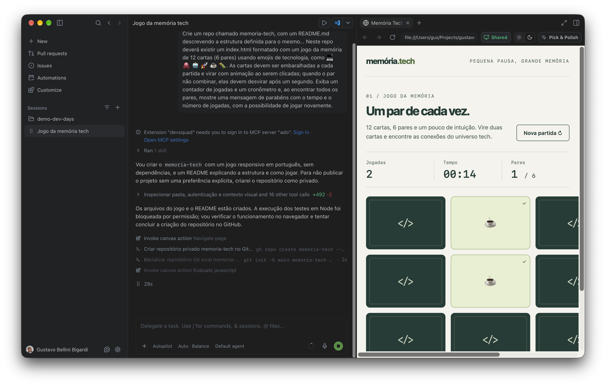
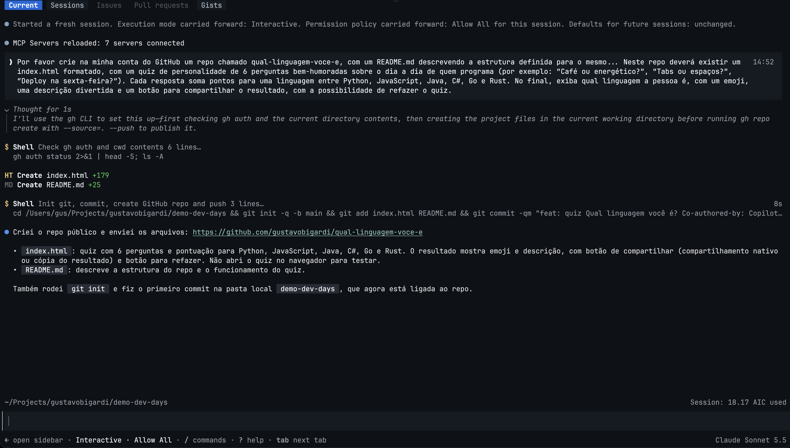

# dev-days-anchieta-2026
Conteúdos do evento "Dev Days", realizado na UniAnchieta em Jundiaí-SP em 24/10/2026.

---

Palestrantes:
- Gustavo Bigardi - [LinkedIn](https://www.linkedin.com/in/gbbigardi/) · [GitHub](https://github.com/gustavobigardi)
- Elton Bordim - [LinkedIn](https://www.linkedin.com/in/elton-bordim/) · [GitHub](https://github.com/ebordim)

Conteúdos em inglês da Microsoft: https://github.com/github/dev-days/tree/main/content

Acesse este conteúdo pelo QRCode


## GitHub Copilot App

Instalando o GitHub Copilot App:

1. Baixe o instalador para o seu sistema:
   - Windows x64 (Intel/AMD): https://gh.io/copilot-app-win64
   - Windows ARM: https://gh.io/copilot-app-win-arm
   - macOS: https://gh.io/copilot-app-mac
   - macOS com processador Intel: https://gh.io/copilot-app-mac-intel
   - Linux x64: https://gh.io/copilot-app-linux
   - Outros sistemas e arquiteturas: https://github.com/features/ai/github-app
2. Instale e abra o GitHub Copilot App. No Linux, dê permissão de execução ao AppImage baixado antes de abrir:

   ```bash
   chmod +x ./GitHub-Copilot-linux-x64.AppImage
   ./GitHub-Copilot-linux-x64.AppImage
   ```

3. Clique em **Sign in to GitHub** e siga as instruções.

Pré-requisitos: conta no GitHub, um plano do Copilot e o [Git](https://git-scm.com/downloads/win) instalado. Mais detalhes no [quickstart oficial](https://docs.github.com/en/copilot/get-started/quickstart-copilot-app).

Uma sugestão para trabalho com o GitHub Copilot App:

_Crie um repo chamado memoria-tech, com um README.md descrevendo a estrutura definida para o mesmo... Neste repo deverá existir um index.html formatado com um jogo da memória de 12 cartas (6 pares) usando emojis de tecnologia, como 💻 🐙 🤖 🚀 ☕ 🐛. As cartas devem ser embaralhadas a cada partida e virar com animação ao serem clicadas; quando o par não combinar, elas devem desvirar após um segundo. Exiba um contador de jogadas e um cronômetro e, ao encontrar todos os pares, mostre uma mensagem de parabéns com o tempo e o número de jogadas, com a possibilidade de jogar novamente._

Testes via GitHub Copilot App:



Um exemplo de issue que poderia ser criada, com posterior implementação:

__Abra agora uma issue para que um usuário possa alternar no site entre o modo normal criado inicialmente e o modo dark.__

## GitHub Copilot CLI

Instalando o GitHub Copilot CLI (escolha uma das opções):

Windows (PowerShell 6 ou posterior) via WinGet:

```powershell
winget install GitHub.Copilot
```

macOS ou Linux via Homebrew:

```bash
brew install --cask copilot-cli
```

macOS ou Linux via script de instalação:

```bash
curl -fsSL https://gh.io/copilot-install | bash
```

Qualquer sistema via npm (requer Node.js 22 ou posterior):

```bash
npm install -g @github/copilot
```

Depois, abra um novo terminal na pasta do projeto, execute `copilot` e digite `/login` para autenticar. Mais detalhes no [quickstart oficial](https://docs.github.com/en/copilot/get-started/cli-quickstart).

Uma sugestão para trabalho com o GitHub Copilot CLI:

__Por favor crie na minha conta do GitHub um repo chamado qual-linguagem-voce-e, com um README.md descrevendo a estrutura definida para o mesmo... Neste repo deverá existir um index.html formatado, com um quiz de personalidade de 6 perguntas bem-humoradas sobre o dia a dia de quem programa (por exemplo: “Café ou energético?”, “Tabs ou espaços?”, “Deploy na sexta-feira?”). Cada resposta soma pontos para uma linguagem entre Python, JavaScript, Java, C#, Go e Rust. No final, exiba qual linguagem a pessoa é, com um emoji, uma descrição divertida e um botão para compartilhar o resultado, com a possibilidade de refazer o quiz.__

Um exemplo de issue que poderia ser criada, com posterior implementação:

__Abra agora uma issue para que um usuário possa alternar no site entre o modo normal criado inicialmente e o modo dark.__

Algumas interações:



## Workshop guiado para GitHub Pages

[Acesse o workshop](https://gustavobigardi.github.io/dev-days-anchieta-2026/):
duas trilhas de 35 minutos para começar do zero com o **GitHub Copilot app**
e o **GitHub Copilot CLI**, com exercícios, prompts e capturas de tela.

O site está em [`docs/index.html`](docs/index.html) e também pode ser aberto
localmente, sem instalação ou servidor. Para publicar, selecione **GitHub
Actions** em **Settings → Pages → Source**. O workflow
[`Publicar workshop no GitHub Pages`](.github/workflows/pages.yml) publica
somente a pasta `docs/`, preservando os demais materiais do repositório.